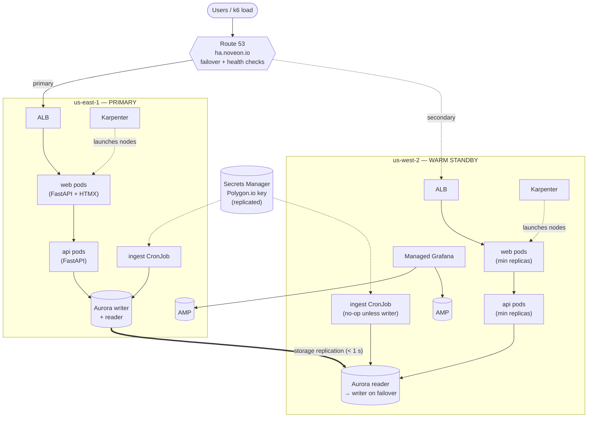
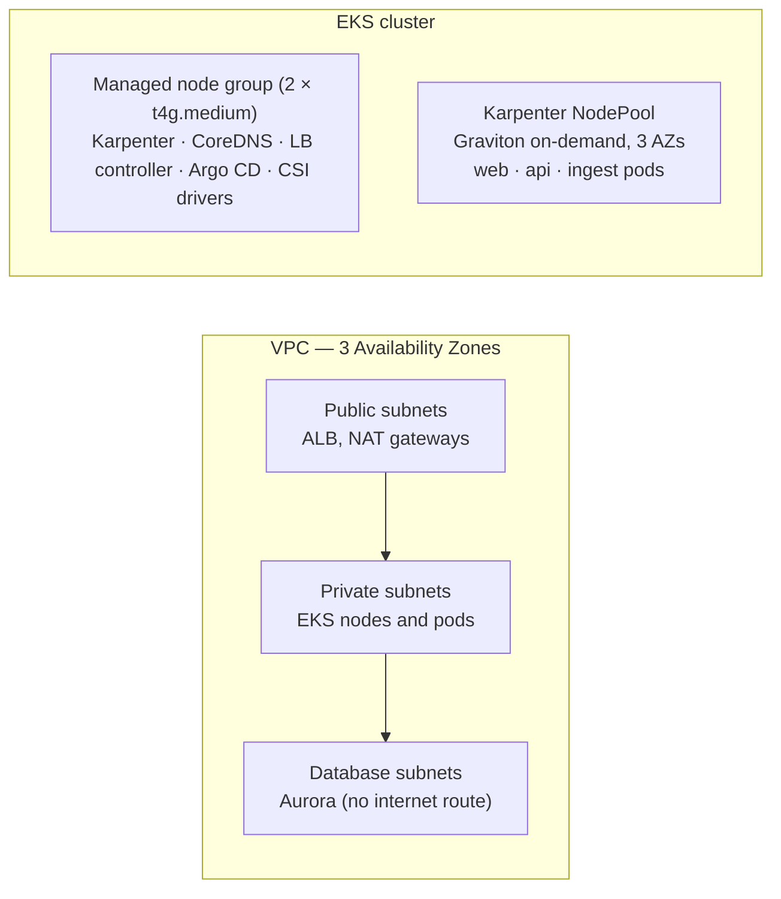

# Architecture overview

## In one paragraph

A three-tier stock dashboard runs on **two independent EKS clusters**, one in
**us-east-1** (primary) and one in **us-west-2** (warm standby). Each cluster
spreads across three Availability Zones, and **Karpenter** adds and removes
nodes as load changes. Data lives in an **Aurora PostgreSQL Global Database**
whose writer is in us-east-1, replicated to a reader in us-west-2.
**Route 53** sends all users to us-east-1 while it is healthy and to us-west-2
when it isn't. Everything is built by **Terraform** through GitHub pull
requests, with **no static secrets** anywhere.

## Picture

## The three tiers

| Tier | What runs | Scales by |
|---|---|---|
| Presentation | `web` — server-rendered pages (FastAPI, Jinja2, HTMX) | Pod autoscaling on CPU / request rate; Karpenter adds nodes |
| Application | `api` — JSON API computing indicators per request | Same |
| Data | Aurora PostgreSQL Serverless v2 (Global Database) | Aurora capacity units (0.5–8 ACU) |

## Inside one region

## The accounts

| Account | ID | Holds |
|---|---|---|
| Management | `223703744147` | Organization, billing, organization CloudTrail |
| Identity Delegated Admin | `821672147486` | IAM Identity Center administration (personas) |
| Workload — "Try Catch Finally" | `093736401430` | Everything in the diagrams above |

## Failure scenarios the demo exercises

| Scenario | What happens | What we watch |
|---|---|---|
| Load rises | Pod autoscaler adds pods → pods can't fit → Karpenter launches nodes in ~1 min | Pending pods, node count, request latency |
| Load falls | Pods scale in → Karpenter consolidates and removes nodes | Node count shrinking, cost per hour |
| Nodes terminated (FIS) | Pods rescheduled; Karpenter replaces capacity | Error rate stays low thanks to PodDisruptionBudgets and spread |
| AZ power interruption (FIS) | Capacity is rebuilt in the two remaining AZs | Same, plus Aurora in-region failover if the writer was in that AZ |
| Region failure (drill) | Health checks fail → Route 53 moves traffic to us-west-2 → Aurora global failover → Karpenter in us-west-2 scales up | The page banner flips from us-east-1 to us-west-2; error window measured by k6 |

## Where the decisions are explained

See the [ADR index](../adr/README.md).
